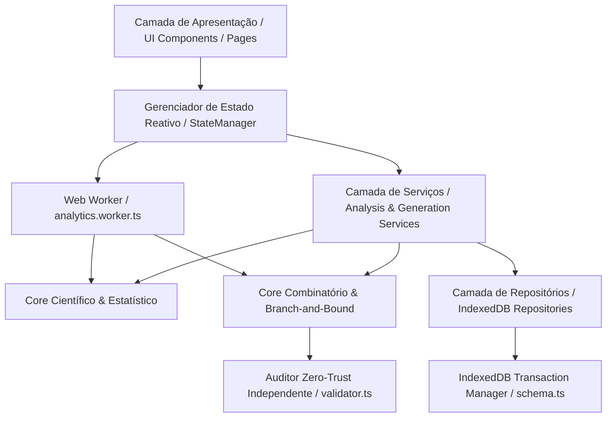

# LOTOFÁCIL QUANT ENGINE — ARQUITETURA DE SOFTWARE

**Documento:** Especificação Arquitetural e Padrões de Projeto (§48)  
**Versão:** `v1.0.0`  
**Status:** `APROVADO & AUDITADO`  

---

## 1. Visão Geral e Princípios Arquiteturais

O **LOTOFÁCIL QUANT ENGINE** adota uma arquitetura em camadas concêntricas estritamente desacoplada, orientada a tipos e funções puras, projetada para execução 100% *client-side* (*offline-first*).

### Princípios Inegociáveis (§1, §34, §39):
1. **Separação Rígida de Responsabilidades:** A camada de UI **nunca** acessa o IndexedDB diretamente; todo acesso passa pelos Repositórios e Gerenciador de Estado.
2. **Núcleo Matemático Puro:** Os módulos estatísticos e combinatórios em `src/core/` são funções matemáticas puras, sem efeitos colaterais, sem dependência de DOM e testáveis isoladamente.
3. **Auditoria Zero-Trust (§31, §39):** O módulo gerador de candidatos (`candidateGenerator.ts` + `optimizer.ts`) e o módulo auditor (`validator.ts`) são completamente independentes. O gerador nunca certifica a si mesmo. Se um único jogo falhar em qualquer critério duro ou na distância mínima de Hamming, o portfólio inteiro é rejeitado.
4. **Não Bloqueio da Thread Principal (§32):** Operações pesadas (análise de milhares de concursos, cálculo de qui-quadrado, matrizes de Markov 25×25, coocorrência de pares/trincas e DFS de combinações) são despachadas para o `analytics.worker.ts`.
5. **Determinismo Científico (§24, §46):** Toda geração e amostragem é controlada pelo PRNG pseudo-aleatório `xoshiro128**` com semente reproduzível. A mesma semente sobre a mesma base de dados produz rigorosamente os mesmos jogos e métricas em qualquer ambiente.

---

## 2. Camadas da Aplicação

### 2.1. Camada de Domínio (`src/core/domain/`)
* **`constants.ts`:** Fonte única de verdade matemática: tamanho do universo ($N=25$), tamanho do volante ($n=15$), subconjuntos de primos, fibonacci, moldura, miolo, pares, ímpares, máscaras binárias de linhas e colunas.
* **`types.ts`:** Tipagem estrita de concursos, filtros duros (`HardConstraints`), diagnósticos de viabilidade (`FeasibilityDiagnosis`), pesos heurísticos, portfólio e auditoria.
* **`features.ts`:** Funções puras que operam sobre arrays de dezenas ou máscaras binárias (cálculo de soma, contagens, entropia espacial).
* **`version.ts`:** Constantes de versão do motor (`ENGINE_VERSION = '1.0.0'`), versão do esquema (`SCHEMA_VERSION = 1`) e identificação da aplicação.

### 2.2. Camada Estatística & Científica (`src/core/statistics/`)
* **`combinations.ts`:** Cálculo de combinações binomiais $C(n, k)$ sem overflow numérico e espaço amostral $C(25, 15) = 3.268.760$.
* **`hypergeometric.ts`:** PMF, CDF e momentos de contagens sem reposição com fator de correção para população finita.
* **`chiSquare.ts`:** Teste de equiprobabilidade das 25 dezenas com relatório duplo transparente: estatística clássica de Pearson e estatística rigorosamente ajustada para amostragem sem reposição ($\chi^2_{\text{adj}} = \chi^2 \times 2.4$).
* **`markov.ts`:** Cadeia de Markov de 1ª ordem com matrizes $25 \times 25$ de presença condicional e ausência condicional.
* **`cooccurrence.ts` & `relationships.ts`:** Contagem e inferência rigorosa de associação entre pares ($C(25,2) = 300$). Separação de Teste A (equiprobabilidade binomial $p=0.35$) e Teste B (condicional nas marginais com fator estrutural exato de $35/36$ de amostragem sem reposição). Controle estrito de falsa taxa de descoberta (FDR) via Benjamini-Hochberg.
* **`covariance.ts`:** Matriz de covariância estrutural comprovando a dependência invariante $\text{Cov}(X_i, X_j) = -0.0100$ e $\text{Corr} \approx -0.04167$.
* **`delays.ts`:** Rastreamento de gaps de ausência, atrasos médios, atrasos máximos, cauda geométrica exata $P(\text{Delay} \ge k) = 0.40^k$ e surpresa de Shannon $I(k) = k \log_2(2.5)$.
* **`entropy.ts`:** Entropia espacial de Shannon sobre partição cartesiana $5 \times 5$.

### 2.3. Camada Combinatória & Otimização (`src/core/combinatorial/`)
* **`filters.ts`:** Compilação de restrições duras em máscaras bitwise e **diagnóstico precoce de viabilidade**: aborta imediatamente antes da busca se cotas térmicas ou intervalos forem mutuamente exclusivos ou impossíveis (§12, §40).
* **`candidateGenerator.ts`:** Busca em árvore DFS com tabelas de limites sufixais $O(1)$, permutação PRNG Fisher-Yates por semente e amostragem por reservatório de Vitter (Algoritmo R). Elimina viés do prefixo 01 e garante amostragem uniforme sobre o espaço viável.
* **`scoring.ts`:** Normalização linear estrita $[0, 1]$ de cada dimensão heurística com matriz pré-computada $25 \times 25$ de relações em $O(1)$ e suavização de Markov Dirichlet-Multinomial.
* **`hamming.ts`:** Distância de Hamming bitwise via `popcount(maskA ^ maskB)`. Como cada aposta possui 15 dezenas, $d_H(A, B) = 30 - 2|A \cap B|$, resultando sempre em números pares ($d_H \ge 4, 6, 8, 10$).
* **`optimizer.ts`:** Algoritmo metaheurístico GRASP (*Greedy Randomized Adaptive Search Procedure*) com avaliação da função-objetivo alinhada à estratégia selecionada, cálculo de exposição em $O(25)$ sem alocação e refinamento local por 1-Swap Local Search.
* **`validator.ts`:** Auditor dual independente que revalida cada jogo gerado em isolamento completo.
* **`exactCoverage.ts`:** Avaliação exata de cobertura no espaço amostral completo $C(25, 15) = 3.268.760$ estados em $< 100$ ms via enumeração por Truque de Gosper e lookup table POPCOUNT_16. Neutraliza apostas duplicadas e calcula métricas de Covering Designs e eficiência da união de Boole.

### 2.4. Camada de Backtest & Validação Científica (`src/core/backtest/`)
* **`walkForward.ts`:** Motor de validação Walk-Forward estritamente fora da amostra sem vazamento de dados (*zero lookahead bias*). Avaliação pareada contra benchmark aleatório com intervalo de confiança de 95% e veredito epistemológico formal (`SEM_EVIDENCIA_SUFICIENTE_CONTRA_H0`).
* **Geração Exata de Linhas Balanceadas:** Geração determinística e uniforme a partir das 51 partições inteiras válidas de 15 em 5 partes no intervalo $[2, 4]$, com zero violações e sem necessidade de fallback degenerado.

### 2.4. Camada de Persistência (`src/storage/`)
* **IndexedDB Nativo:** Banco `LotofacilQuantEngineDB` (schema v1) contendo 6 object stores: `datasets`, `contests`, `analyses`, `configurations`, `generated_games`, `scientific_reports`.
* **Transações Atômicas:** Operações de escrita em lote (`dbPutBatch`) para assegurar integridade referencial.
* **Repositórios Especializados:** `datasetRepository`, `analysisRepository`, `gamesRepository`, `configRepository`.

### 2.5. Camada de Apresentação e Estado (`src/app/`, `src/pages/`, `src/components/`)
* **`StateManager`:** Singleton reativo observável que gerencia a rota ativa, snapshot de dados, configurações, progresso assíncrono e comunicação com o Web Worker.
* **10 Telas Analíticas:** Dashboard, Histórico, Estatística, Markov, Coocorrência, Entropia, Gerador Combinatório, Jogos Gerados, Relatórios Técnicos e Configurações/Backup.
* **Taxonomia Visual de Badges:** Badges coloridos obrigatórios em todas as visualizações (`epistemicBadge.ts`).

---

## 3. Segurança e Backup com Rollback Atômico (§35)

O serviço de backup (`backupService.ts`) adota um protocolo de tolerância a falhas em 5 fases:
1. **Exportação:** Exporta JSON estruturado com metadados do engine, schema e hash canônico SHA-256 dos dados brutos.
2. **Validação Estrutural:** Ao importar, decodifica o arquivo, inspeciona campos obrigatórios e recalcula o checksum SHA-256. Qualquer divergência aborta a operação sem modificar o banco.
3. **Pré-Visualização:** Apresenta modal com a contagem exata de registros por tabela antes de solicitar confirmação ao usuário.
4. **Snapshot de Rollback:** Antes de limpar o banco ativo, o serviço grava em memória um snapshot completo de todas as stores existentes.
5. **Restauração ou Reversão:** Se ocorrer qualquer erro durante a escrita dos novos registros, o rollback é imediatamente acionado, restaurando o snapshot anterior com integridade 100% garantida.
